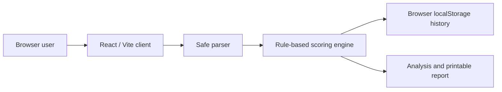

# Architecture

This deployable static demonstration uses no network requests for user email content. The engine extracts basic headers and plaintext URLs, classifies untrusted `Authentication-Results` values, and applies bounded explainable weights. It never follows a URL or renders supplied HTML.

## Production architecture (not included)

React client → authenticated Vercel API routes → managed PostgreSQL; a trusted mail-security source supplies server-side authentication evidence. DNS evaluation runs only with validated domains, timeouts, and no arbitrary URL fetches. Records are keyed to the authenticated user.
